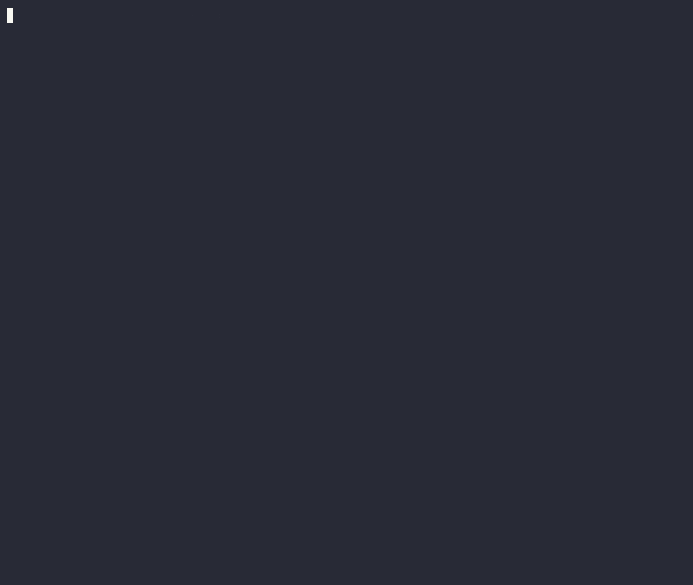

<p align="center">
  
</p>

# LocalHarness

[](https://github.com/ahwurm/localharness/stargazers) [](LICENSE)

**Run AI agents on the models you already run locally.**

LocalHarness is an open-source, self-hosted agent harness for local LLMs. It connects to a model you serve over an OpenAI-compatible API (vLLM, llama.cpp, Ollama or LM Studio), or starts one for you, and gives it agents, defined in YAML, with tools, MCP servers, a permission gate in front of every tool call, and helper agents that each work in a fresh context with only the tools they are allowed. A small core runs the agent loop; memory, the phone app, Discord, image generation, the self-improvement loop and a headless browser for JavaScript-rendered pages are plugins that you turn on or off with one command. Use it as a coding and research agent on your own machine, with no account and no telemetry.



## Why an agent harness for local models

- **Local models.** The harness sizes a launch from the model's own files. It reads the served, trained and fitted context windows, prices a llama.cpp launch from the GGUF tensor table, keeps an MoE's experts in RAM when the GPU cannot hold them, and refuses a model that fits nowhere. It will not launch below the window the agent loop needs. A model without native tool calling gets an XML fallback. `/effort off|low|high|max` caps how much a model may think per request.
- **The model server.** `localharness start` finds a model on your machine or offers one to fetch, writes it a preset (KV cache type, drafting and parsers are chosen at launch), serves it, and remembers your last choice. `/model` lists every launch this box can make, each with its runtime, weight placement and window, and switches in place. `localharness model --autostart on` starts the server with the harness, and `localharness model --script` prints the launch as a shell script. A turn survives a server restart.
- **Private by default.** Memory is SQLite in your home directory, config is YAML, and the event stream, logs and bench results stay on your disk. Plugins, tool hooks and the phone app use the same event bus and public plugin API as the bundled plugins. No account, no telemetry ([what `start` contacts](SECURITY.md#what-localharness-start-contacts)); web search runs over DuckDuckGo with no key. MIT licensed.
- **Permissions.** One permission gate stands in front of every tool call, helper agents included. An agent that reads untrusted content, a web page or an MCP result, is not given tools that change your machine; the check runs when an agent's tools resolve and fails closed. The endpoint, credential and allowed senders are set in machine-level config, and a cloned repository cannot change them. Threat model: [SECURITY.md](SECURITY.md).

## Quick start

Python 3.12 or later and [uv](https://docs.astral.sh/uv/). You do not need a running model server: the first `localharness start` finds a model on your machine or offers one to fetch.

```bash
uv tool install 'localharness[embeddings,mobile]'  # memory's CPU model + the phone app's dependencies (`plugins enable mobile` turns it on)
localharness start                   # finds a model (or offers one), sets up, opens a session

localharness plugins list            # every plugin and whether it is on
localharness plugins disable autoresearch
localharness plugins enable image --set comfyui_url=http://127.0.0.1:8188
localharness update                  # the latest release from PyPI
```

`plugins enable` and `plugins disable` write `overrides.yaml` and leave your `config.yaml` alone; `--workspace` changes a bundled plugin for one project only. Inside a session, `/plugins enable <name>` asks what the plugin needs, checks it, and restarts with your conversation kept. Keyboard shortcuts and multi-line input: [docs/terminal-keys.md](docs/terminal-keys.md).

## What agents can do

Agents are YAML. A project's agents live in its `.localharness/agents/` and yours in `~/.localharness/agents/`, the project's file winning a shared name; the model is told about both and sees a new one as soon as it is used or created, and `localharness agent list` shows where each comes from. The built-in tools are read, write, edit, glob, grep, bash, python, web search and fetch, delegation to helper agents, and MCP servers, so a session works as a coding agent or a research agent. Drive it from the terminal, from Zed ([`localharness acp`](docs/zed.md)), from your phone on your own network ([`localharness mobile`](docs/mobile.md)) or from Discord ([`--channel discord`](docs/plugins/dispatch.md)). With a vision model, drop a screenshot on the terminal, paste one into Zed or the phone page, or attach one on Discord.

## Supported runtimes

Point it at vLLM, llama.cpp, Ollama or LM Studio; the agents, tools, permission gate and plugins are the same on all four. Every runtime is reached through one OpenAI-compatible client, and `init` can attach to an endpoint that is already running. Live-validated means run on the [DGX Spark](docs/reference-architectures/dgx-spark.md) reference machine; recorded bench runs exist for vLLM only.

| Runtime | Harness starts the server | Tool calling | Token counting | Live-validated |
|---|---|---|---|---|
| **vLLM** | docker or binary | native | exact | reference machine and bench |
| **llama.cpp** | spawns `llama-server` | XML / Hermes fallback | exact | reference machine |
| **Ollama** | spawns `ollama serve` | native | exact with the `exact-tokenizer` extra, else estimated | CPU round-trip |
| **LM Studio** | drives headless `lms` | native | exact with the `exact-tokenizer` extra, else estimated | CPU round-trip |

A session with no temperature set sends none, so the server's sampling defaults apply; pin one on the server (llama-server's `--temp`, vLLM's `--generation-config`). Setup: [llama.cpp](docs/runtimes/llamacpp.md), [Ollama](docs/runtimes/ollama.md), [LM Studio](docs/runtimes/lmstudio.md), vLLM ([reference architectures](docs/reference-architectures/README.md)); the code is [the provider layer](src/localharness/provider/).

## Plugins

| Name | What it does | Default | How to switch |
|------|--------------|---------|---------------|
| `image` | makes pictures with ComfyUI | off | `localharness plugins enable image --set comfyui_url=<url>` |
| `mobile` | Mobile: the phone page, served with its event API by `localharness mobile` | off; needs `localharness[mobile]` | `uv tool install 'localharness[mobile]'` (name the other extras you use too: a reinstall keeps only the ones it names), then `localharness plugins enable mobile --set public_url=<url>` |
| `memory` | persistent memory: facts recalled into each turn, memory tools, background consolidation | on | `localharness plugins disable memory` |
| `dispatch` | chat: Discord | off; needs `localharness[dispatch]` | `uv tool install 'localharness[dispatch]'` (name the other extras you use too: a reinstall keeps only the ones it names), then `localharness plugins enable dispatch --set discord.token=… --set discord.allow=<your user id>` |
| `autoresearch` | experiment loop | on | `localharness plugins disable autoresearch` |
| `browser` | reads JavaScript-rendered pages through a sandboxed headless Chromium and clicks through them anonymously | off; needs `localharness[browser]` | `uv tool install 'localharness[browser]'` (name the other extras you use too: a reinstall keeps only the ones it names), then `localharness plugins enable browser` |

Pages: [image](docs/plugins/image.md) · [mobile](docs/plugins/mobile.md) · [memory](docs/plugins/memory.md) · [dispatch](docs/plugins/dispatch.md) · [autoresearch](docs/plugins/autoresearch.md) · [browser](docs/plugins/browser.md), and on the site: [image](https://localharness.dev/plugins/image/) · [mobile](https://localharness.dev/plugins/mobile/) · [memory](https://localharness.dev/plugins/memory/) · [dispatch](https://localharness.dev/plugins/dispatch/) · [autoresearch](https://localharness.dev/plugins/autoresearch/) · [browser](https://localharness.dev/plugins/browser/).

Installed plugins live on your machine, not inside a project: a Python package with a `localharness.plugins` entry point beside LocalHarness, or a folder `~/.localharness/plugins/<name>/`. None of its code is imported until `localharness plugins enable <name>`, which only your machine-level config can do. A plugin you turn on is trusted code that runs with your privileges: read [SECURITY.md](SECURITY.md#plugins) before you enable one.

## Write a plugin

Copy [the example plugin](examples/plugin-template/README.md): one tool, one command, one slash command, one `doctor` check and two settings, tested in CI. The API is [`plugins/api.py`](src/localharness/plugins/api.py); its version is `"1"`, and changes since its first release have only added optional fields. Plugins written for the previous plugin API no longer load; [the example plugin](examples/plugin-template/README.md#plugins-written-for-015) says how to port one.

## Skills

A skill is a folder holding a `SKILL.md` in the open [Agent Skills](https://agentskills.io/specification) format: a name, a one-line description of when to use it, and a procedure. LocalHarness reads a project's `.localharness/skills/` and `.agents/skills/`, `~/.localharness/skills/` and the bundled set. The model sees one line per skill and loads the procedure with its `skill` tool when a request matches. The model may not pick a skill up on its own; `/<name>` asks it to. When the memory plugin is on, the harness may also cue a skill from the request, shown in the terminal as a dim `hint to the model: skill <name>` line, with whatever embedding model the memory plugin uses. From the next start after that model is on this machine, the harness measures the cue's threshold in the background, yielding to your turns (a few minutes of CPU), and the cue starts once that is done; an upgrade that changes the labelled set, or a new embedding model, measures once more. There is nothing to run; `localharness doctor` shows the state. Turning the memory plugin off also turns the cue off. The root's prompt also carries a short map of where the project, its skills and its agents live and how a skill or an agent call enters a task.

`localharness skills` lists what was found and why anything was skipped, and `/skill-creator` writes a new one with you, one approval per file. A skill is text: it grants no tool and installs nothing. A project's skills load with its config, so read them in a repository you did not write: [SECURITY.md](SECURITY.md#skills).

## Status

Early stage (v0.25.0, pre-1.0). Interfaces and config schema may change without notice. Each release's known limitations are listed in the [CHANGELOG](CHANGELOG.md).

## Links

- [SECURITY.md](SECURITY.md): trust boundaries, the permission gate, the prompt-injection threat model
- [src/localharness/](src/localharness/): the source, one package per component; the CLI is [`cli/`](src/localharness/cli/)
- [docs/task-context.md](docs/task-context.md): how a session keeps a working record for substantive work, with an [example workflow](examples/workflows/research-note/)
- [docs/reference-architectures/](docs/reference-architectures/README.md): tested hardware and setup notes
- [docs/running-agents-locally.md](docs/running-agents-locally.md): where LocalHarness fits among local agent tools, and where it is behind
- [LocalShift](https://github.com/ahwurm/localshift): the companion project that moves a headless Claude Code job onto LocalHarness once a local model proves good enough
- [localharness.dev](https://localharness.dev)

## License

[MIT](LICENSE)
